# HP Prime HVAC apps

Color, touchscreen apps for HVAC/R and electricity classes on the **HP Prime G1**. All of them also run on the G2.

| App | What it does | Download |
|---|---|---|
| **[SUPERSUB](#supersub-superheat-and-subcooling-for-the-hp-prime)** | Superheat and subcooling on draggable manifold gauges, a P-T chart for 30 refrigerants, and service tools for the refrigerant circuit | [`SUPERSUB.zip`](https://github.com/christophercasteel2/Subheat-subcool-app/raw/ccr-d1b6c2f8-hvvb6p/calculator/SUPERSUB.zip) |
| **[HVACAIR](#hvacair-airside-tools-the-rebuilt-hvac-suite)** | The rebuilt HVAC Suite: 20 airside tools, including psychrometrics, coil capacity, furnace temperature rise, static pressure, duct sizing, fan laws, pulleys and quick loads | [`HVACAIR.zip`](https://github.com/christophercasteel2/Subheat-subcool-app/raw/ccr-d1b6c2f8-hvvb6p/calculator/HVACAIR.zip) |
| **[HVACELEC](#hvacelec-electrical-tools-for-the-hp-prime)** | 20 electrical tools: Ohm's law, motor and compressor checks, capacitor and thermistor tests, NEC wire and breaker sizing, MCA / MOCP, voltage drop and more | [`HVACELEC.zip`](https://github.com/christophercasteel2/Subheat-subcool-app/raw/ccr-d1b6c2f8-hvvb6p/calculator/HVACELEC.zip) |
| **[NECCALC](#neccalc-nec-calculator-for-electrical-class)** | A study app for electrical class with every calculator, chart and guide of electricalcalctools.com (19 tools: voltage drop, wire size, ampacity for every insulation type in a raceway or free air, breaker, conduit fill, AWG, feeder, ground wire, box fill, MCA/MOCP, power, Ohm's law, kWh, cost, derating, drop table, breaker/wire chart, appliances, NEMA) plus NEC notes. Separate from HVACELEC, so you can delete it after the class | [`NECCALC.zip`](https://github.com/christophercasteel2/Subheat-subcool-app/raw/ccr-d1b6c2f8-hvvb6p/calculator/NECCALC.zip) |
| **[HVACGAS](#hvacgas-gas-heating-and-piping)** | Gas heating and piping, set up for Arkansas: gas pipe sizing from the 2018 Arkansas Fuel Gas Code tables (plus propane reference tables), combustion air, meter clocking, manifold pressure, flue gas, pressure tests, oil nozzles, copper and steel pipe data, offsets, expansion and brazing alloys | [`HVACGAS.zip`](https://github.com/christophercasteel2/Subheat-subcool-app/raw/ccr-d1b6c2f8-hvvb6p/calculator/HVACGAS.zip) |
| **[REFCYCLE](#refcycle-refrigeration-cycle-and-service)** | The refrigeration cycle from saturation temperatures or gauge pressures (enthalpy at each point, refrigeration effect, COP, mass flow), refrigerant property look-ups, compressors, walk-in box loads, the 2026 EPA leak repair and evacuation rules, and service paperwork | [`REFCYCLE.zip`](https://github.com/christophercasteel2/Subheat-subcool-app/raw/ccr-d1b6c2f8-hvvb6p/calculator/REFCYCLE.zip) |
| **[CIRCUITS](#circuits-dc-circuits-for-electricity-class)** | DC circuits for electricity class: series, parallel, series-parallel and combination circuits (RT, IT, ET and every resistor's voltage, current and power), finding an open or shorted resistor, Kirchhoff's voltage and current laws, a two-source network, Ohm's law and power, dividers, the color code and metric prefixes | [`CIRCUITS.zip`](https://github.com/christophercasteel2/Subheat-subcool-app/raw/ccr-d1b6c2f8-hvvb6p/calculator/CIRCUITS.zip) |

They all install the same way (see [Install](#install-drag-and-drop-no-typing)), and you can have all of them on the calculator at once.

**On an Android phone:** every app is also an Android app: [SUPERSUB](https://github.com/christophercasteel2/Subheat-subcool-app/raw/ccr-d1b6c2f8-hvvb6p/android/SUPERSUB.apk) · [HVACAIR](https://github.com/christophercasteel2/Subheat-subcool-app/raw/ccr-d1b6c2f8-hvvb6p/android/HVACAIR.apk) · [NECCALC](https://github.com/christophercasteel2/Subheat-subcool-app/raw/ccr-d1b6c2f8-hvvb6p/android/NECCALC.apk) · [HVACELEC](https://github.com/christophercasteel2/Subheat-subcool-app/raw/ccr-d1b6c2f8-hvvb6p/android/HVACELEC.apk) · [HVACGAS](https://github.com/christophercasteel2/Subheat-subcool-app/raw/ccr-d1b6c2f8-hvvb6p/android/HVACGAS.apk) · [REFCYCLE](https://github.com/christophercasteel2/Subheat-subcool-app/raw/ccr-d1b6c2f8-hvvb6p/android/REFCYCLE.apk) · [CIRCUITS](https://github.com/christophercasteel2/Subheat-subcool-app/raw/ccr-d1b6c2f8-hvvb6p/android/CIRCUITS.apk). See [Android apps](#android-apps).

# SUPERSUB: superheat and subcooling for the HP Prime

A color, touchscreen superheat and subcooling calculator for the **HP Prime G1** (it also runs on the G2). It is built around a pair of analog manifold gauges that you set by dragging the needles, plus a full pressure-temperature (P-T) chart and a set of service tools for the refrigerant circuit.

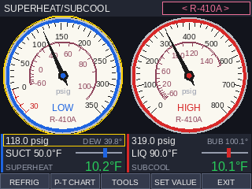 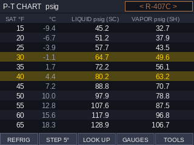

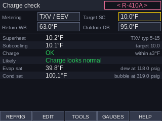 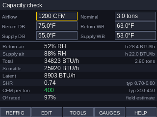

*Screens rendered by the development simulator (`tools/ppl_sim.py`). On the calculator, fonts look slightly different.*

## Features

- **Manifold gauges.** The low side is a blue compound gauge that reads from 30 inHg of vacuum up to 350 psig. The high side is a red gauge that reads 0–800 psig. Each dial has a temperature ring for the selected refrigerant, like the scales printed on a real gauge face. The low ring shows dew-point temperatures and the high ring shows bubble-point temperatures.
- **Touch control.** Drag a needle, or tap anywhere on a dial, to set the pressure. Drag the SUCT and LIQ sliders to set the line temperatures. You can also use the arrow keys, or type an exact value.
- **Live results.** Superheat and subcooling update as you move the needles and sliders, color-coded green, yellow or red.
- **P-T chart.** A scrolling table: each row is a saturation temperature (°F, with °C) and the pressure at that temperature, in 1°F or 5°F rows. Single refrigerants and azeotropes (R-22, R-134a, R-32 ...) have one pressure column. Blends with glide have two: LIQUID (bubble), the one to use for subcooling, and VAPOR (dew), the one to use for superheat. Vacuum readings show in red as inHg. You can look up a value by temperature or by pressure, and pressure look-ups also report the glide.
- **Service tools.** Full check (every reading on one screen, A/C cooling or heat pump heating), charge check, system check, capacity check, line set charge, nitrogen test, vacuum, recovery cylinder, refrigerant info, unit converter and an altitude setting. See [Tools](#tools) below.
- **30 refrigerants, including phased-out ones still found in the field.** See [Refrigerants](#refrigerants) below.

## Install (drag and drop, no typing)

The ready-made calculator files are in the [`calculator`](calculator) folder.

1. **Download** [`SUPERSUB.zip`](https://github.com/christophercasteel2/Subheat-subcool-app/raw/ccr-d1b6c2f8-hvvb6p/calculator/SUPERSUB.zip) and unzip it. On Windows, right-click it and choose **Extract All**; on a Mac, double-click it. You get a folder called `SUPERSUB.hpappdir` and a file called `SUPERSUB.hpprgm`. Drag from the unzipped copy; dragging straight out of the zip often fails.
2. **Connect** the calculator to the computer with its USB cable, turn it on, and open the free **HP Connectivity Kit**. Your calculator appears in the **Calculators** panel on the left. Click the small arrow next to it to see its contents.
3. **Drag the `SUPERSUB.hpappdir` folder** onto **Application Library** under your calculator.
4. On the calculator, press the **Apps** key and tap the **SUPERSUB** icon. It opens straight onto the gauges.

**If the app doesn't appear or won't open:** try the plain program instead. Drag `SUPERSUB.hpprgm` onto **Programs** under your calculator, then on the calculator press **Shift** then **1** (Program), select **SUPERSUB** and tap **Run**. The files are built for current firmware (2.4 and later); if your calculator is older, update it through the Connectivity Kit first.

Install one or the other, not both. To update later, drag the new copy over the old one and accept the replace prompt. Your last pressures, temperatures and refrigerant are kept between runs, but they reset when you install a new version.

To try it without a calculator, drag the same files into HP's free **HP Prime Virtual Calculator**, which appears in the Connectivity Kit too.

## Using it

**Gauge screen**

| Action | Touch | Keys |
|---|---|---|
| Set suction or liquid pressure | Drag the needle, or tap the dial | Select the gauge, then use Up/Down (±1) or + / − (±10) |
| Set suction or liquid line temp | Drag the SUCT or LIQ slider | Select the slider, then use Up/Down or + / − |
| Choose which control the keys change | Tap it | Left / Right (the selection is outlined in yellow) |
| Type an exact value | **SET VALUE**, or tap a reading a second time | Enter |
| Change refrigerant | **REFRIG**, or tap the refrigerant name | Symb |
| Open the P-T chart | **P-T CHART** | Num |
| Open the service tools | **TOOLS** | Menu |
| Help / quit | Tools list → Help / **EXIT** | Help / Esc |

To enter a vacuum on the low side, type a negative psig value: 1 psi = 2.036 inHg, so 10 inHg is −4.9 psig.

**P-T chart:** scroll with Up/Down, + / −, or by dragging. Left/Right changes the refrigerant. **STEP** switches between 1°F and 5°F rows. **LOOK UP** (or Enter) finds the saturation values for a temperature or a pressure and highlights them in the table.

**Tools:** pick a tool from the **TOOLS** list. The boxes at the top are the inputs: tap one to change it, or use Left/Right to select a box, Up/Down to step it and Enter (or **EDIT**) to type a value. Answers update below the boxes as you go. **HELP** explains how each tool works. Inputs are shared, so the return air readings entered for the charge check are already there in the capacity check, and everything is remembered between runs.

### How it is calculated

- **Superheat** = suction line temp − **dew** temperature at the suction pressure
- **Subcooling** = **bubble** temperature at the liquid pressure − liquid line temp

Using dew on the low side and bubble on the high side keeps the answer correct for blends with glide, such as R-407C, R-448A and R-454B.

Color guide (a reminder only; always use the manufacturer's charging chart):

| | Green | Yellow | Red |
|---|---|---|---|
| Superheat | 5–20°F | 2–5°F or 20–30°F | below 2°F or above 30°F |
| Subcooling | 5–15°F | 2–5°F or 15–25°F | below 2°F or above 25°F |

## Tools

The tools work from the gauge screen's pressures and line temperatures plus a few readings of their own. Typical ranges are for residential and light-commercial comfort cooling; the manufacturer's data always wins.

| Tool | Inputs | What you get |
|---|---|---|
| **Full check** | Mode (A/C cooling or heat pump heating), suction and head pressure, SLT, LLT, DLT, return, supply and outdoor air | Every reading on one screen: evaporator saturation (dew at suction), condensing saturation (bubble at head), superheat (SLT − dew), subcooling (bubble − LLT), discharge superheat (DLT − dew at head), air ΔT, evaporator TD, condenser split, approach, compression ratio, and the likely problem from superheat, subcooling, suction and head together (low charge, overcharge, restriction, weak compressor, low indoor airflow, dirty condenser). In heating mode the indoor coil is the condenser, so the split and approach use return air and the evaporator TD uses outdoor air. Suction, head, SLT and LLT are the same values as on the gauge screen. Supply and return are air temperatures, not dew or bubble points |
| **Charge check** | Metering device, target subcooling, return air wet bulb, outdoor dry bulb | Fixed orifice: target superheat from the standard charging chart, (3 × return WB − 80 − outdoor DB) ÷ 2, valid for 50–76°F WB and 55–115°F outdoor. TXV/EEV: target subcooling from the data plate. An ADD / REMOVE / OK verdict (±3°F by default), the likely cause from the superheat and subcooling pattern, and the evaporator and condensing saturation temperatures |
| **System check** | Return and supply dry bulb, outdoor dry bulb, discharge line temperature | Evaporator TD, condenser split, approach, coil ΔT, compression ratio, and a discharge temperature check (keep under 225°F) |
| **Capacity check** | Airflow, rated tons, return and supply dry bulb and wet bulb | Total, sensible and latent BTU/h, SHR, CFM per ton, % of rated capacity, and the relative humidity and enthalpy of both airstreams (ASHRAE psychrometrics, corrected for elevation) |
| **Line set charge** | Liquid line size, line length, length included in the factory charge, optional oz/ft from the manual | Ounces to add or remove, from the tube's inside diameter and the refrigerant's liquid density at the liquid line temperature |
| **Nitrogen test** | Start pressure and temperature, pressure and temperature now | The pressure expected from the temperature change alone, and whether the system is holding |
| **Vacuum / evacuation** | Microns, and the start, end and minutes of a decay test | The temperature water boils at that vacuum (500 microns ≈ −12°F), the same vacuum in inHg and psia, and a decay test verdict |
| **Recovery cylinder** | Water capacity (WC), tare weight (TW), weight now | Maximum refrigerant by the 80% rule (WC × 0.8 × specific gravity) and the gross weight to stop at |
| **Refrigerant info** | — | Safety class, usual oil, GWP, glide, whether it must be charged as liquid, boiling point, pressures at 40°F and liquid density |
| **Unit converter** | Kind of value, the number and its unit | Pressure (psig, psia, inHg vacuum, kPa, bar, microns), temperature, capacity (BTU/h, tons, MBH, kW, W), airflow, length and weight |
| **Sat temp SH/SC** | Saturated suction temperature, SLT, saturated liquid temperature, LLT | Superheat = SLT − sat suction temperature and subcooling = sat liquid temperature − LLT, straight from saturation temperatures the way a test question gives them (sat 110°F and LLT 100°F: 10°F of subcooling), with no pressures and no rounding. Also lists the pressures at those saturation temperatures for the chosen refrigerant (dew for the suction, bubble for the head). SLT and LLT are the gauge screen's readings |
| **Settings** | Elevation, charge tolerance, saturation temps | Gauges read against the local air, so saturation temperatures, the P-T chart and the dials are corrected for altitude (12.2 psia at 5,000 ft). **Sat temps: Whole °F** rounds the dew and bubble temperatures used for superheat, subcooling and the checks to the nearest degree, the way a printed P-T chart is read, for tests whose answers come from a chart |

## Refrigerants

The chooser lists them in numeric order with their common trade names. R-410A is selected the first time the program runs.

| Group | Refrigerants |
|---|---|
| Current A/C and heat pump | R-32, R-410A, R-454B |
| Legacy A/C | R-22 |
| R-22 retrofit blends | R-407A, R-407C, R-417A (NU-22/MO59), R-421A, R-422B (NU-22B), R-422D (MO29), R-427A (FX-100), R-438A (MO99) |
| Commercial refrigeration | R-404A, R-407F, R-448A (N40), R-449A (XP40), R-452A (XP44), R-507A (AZ-50) |
| Legacy CFCs | R-12, R-500, R-502 |
| R-12 and R-502 retrofit blends | R-401A (MP39), R-402A (HP80), R-408A (FX-10), R-409A (FX-56) |
| Auto and medium temperature | R-134a, R-513A (XP10), R-1234yf |
| Hydrocarbons | R-290 (propane), R-600a (isobutane) |

R-414B (HotShot) is not included yet. The only table I found for it is from a source that read 3–5 psi high on the other HCFC blends. It can be added once a trustworthy chart is available.

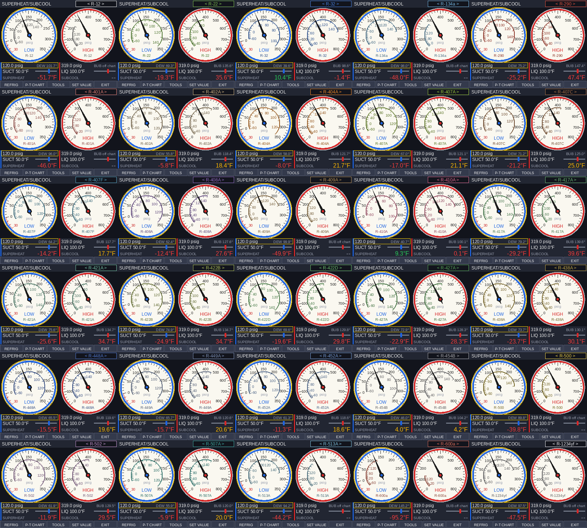

## Accuracy and data sources

The program stores the bubble and dew pressure of each refrigerant every 5°F from −60°F to 150°F, to 0.001 psi. Between rows it interpolates ln(P) linearly in 1/T (absolute temperature), the shape of a real vapor-pressure curve. Against CoolProp that is within 0.003°F from 0°F to 130°F and 0.007°F over the whole table, for every refrigerant CoolProp has. Blends that come from published charts can only be as exact as those charts. A pressure whose saturation temperature falls well outside that range shows `--` instead of a guess. Where a published chart stops at −40°F or −50°F, the table is extended with a Clausius-Clapeyron fit of the chart's lowest rows; tested on CoolProp data, that extension is within 0.01°F over 20°F.

Each refrigerant's data comes from the most authoritative source I could find. Where possible it was cross-checked against a second source:

| Refrigerants | Source | Check |
|---|---|---|
| R-12, R-22, R-32, R-134a, R-290, R-600a, R-1234yf, R-404A, R-407C, R-410A, R-507A | [CoolProp](http://www.coolprop.org) reference equations of state | Within 0.15 psi of Arkema's NIST REFPROP 10 chart, where Arkema lists the refrigerant |
| R-427A, R-448A, R-449A, R-452A, R-513A | Arkema Forane P-T chart (NIST REFPROP 10) | |
| R-408A, R-409A | Arkema Forane P-T wall chart (NIST REFPROP) | R-408A's vapor side is derived from National Refrigerants' glide (about 1°F) |
| R-454B | Chemours *Opteon XL41 Thermodynamic Properties* (NIST REFPROP 10) | Matches Arkema within 0.06 psi |
| R-407A, R-422B, R-500 | National Refrigerants *Refrigerant Reference Guide* | Matches Hudson Technologies' charts within 0.7 psi |
| R-401A, R-402A, R-422D, R-502 | Hudson Technologies P-T charts | R-402A's and R-502's vapor sides are derived from National Refrigerants' glide |
| R-438A | IGAS P-T chart | Matches Hudson's liquid pressures within 0.25 psi |
| R-407F, R-417A, R-421A | CoolProp blend models | Within 0.05 psi (R-407F, R-421A) and 1 psi (R-417A) of Hudson's liquid pressures |

National's full property tables for the HCFC blends (R-401A, R-402A, R-408A, R-409A) read 3–5 psi higher than Arkema's REFPROP data and Hudson's charts. Those tables were not used for these blends.

In Arkema's chart, the vacuum readings for R-448A, R-449A, R-452A and R-513A are printed in psi below atmosphere, although every other column (and the chart's note) uses inHg. Checked against CoolProp and Hudson's charts, they are now stored as psi. Earlier versions of this app read them as inHg, which made R-513A read about 3 psi too high in deep vacuum (below about −20°F). The other three were not affected, because their vacuum rows fell below the old −40°F table limit.

The tools use these extra properties:

| Property | Source |
|---|---|
| Saturated liquid density (line set charge, cylinder fill) | CoolProp for every refrigerant it models (within 0.4 % of Hudson's charts where both exist); Hudson's charts for R-401A, R-402A, R-408A, R-438A, R-500 and R-502; National Refrigerants for R-409A (`tools/data/liquid_density.csv`) |
| GWP | IPCC AR4 values (the basis of the EPA's HFC rules), weighted by each blend's ASHRAE 34 composition |
| Safety class, usual oil | ASHRAE 34 and the refrigerant makers' literature |
| Moist-air properties (capacity check) | ASHRAE Fundamentals relations; checked against CoolProp's humid-air model within 1.5 % |

Every source document is named, with its link, at the top of its CSV in `tools/data/`.

# HVACAIR: airside tools (the rebuilt HVAC Suite)

HVACAIR replaces the HVAC Suite with something a service tech can use on every call. It covers the same ground (psychrometrics, loads, air processes, ducts and fans), but each job is its own tool with a handful of boxes, the same way HVACELEC works. The answers update as you type, colored green (OK), yellow (check it) or red (problem). It has a different name, so installing it does not replace your old HVAC Suite; delete that one when you no longer need it.

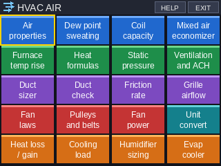 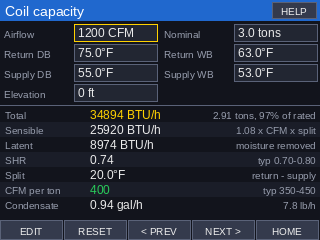

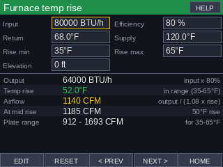 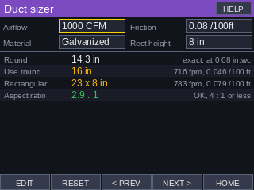

## Installing HVACAIR

Download [`HVACAIR.zip`](https://github.com/christophercasteel2/Subheat-subcool-app/raw/ccr-d1b6c2f8-hvvb6p/calculator/HVACAIR.zip), unzip it, and drag the `HVACAIR.hpappdir` folder onto **Application Library** under your calculator in the Connectivity Kit. If the app doesn't show up, drag `HVACAIR.hpprgm` onto **Programs** instead. On the calculator, press **Apps** and tap **HVACAIR**. It is used exactly like HVACELEC (see [Using HVACELEC](#using-hvacelec)). One extra: the **Elevation** box is shared, so set it once and every moist-air tool corrects for the thinner air.

## HVACAIR tools

| Tile | Inputs | What you get |
|---|---|---|
| **Air properties** | Dry bulb plus RH, wet bulb or dew point; elevation | RH, wet bulb, dew point, grains, enthalpy, specific volume, density, air pressure, and the 1.08 / 4.5 factors at that elevation |
| **Dew point / sweating** | Air temperature, RH, surface temperature | Dew point, the margin, WILL SWEAT / close / OK, and the humidity at which that surface starts to sweat |
| **Coil capacity** | CFM, nominal tons, return and supply dry and wet bulb | Total, sensible and latent BTU/h, tons and % of rated, SHR, split, CFM per ton, and condensate in gal/h |
| **Mixed air / economizer** | Outside and return temperature and RH, % outside air or the measured mixed temperature, CFM | Mixed temperature or % outside air, outside CFM, mixed RH, wet bulb and enthalpy, and whether outside air can help cool |
| **Furnace temp rise** | Input BTU/h, efficiency, return and supply temperature, the plate's rise range | Output, rise checked against the range, CFM = output ÷ (1.08 × rise), and the CFM at mid-range |
| **Air heat formulas** | Find BTU/h, CFM or ΔT; the other two; optional grains difference | Sensible (1.08), latent (0.68) and total heat, corrected for elevation |
| **Static pressure** | Supply and return static, rated ESP, optional filter and coil drops | Total external static, % of rated, and how much each part uses |
| **Ventilation and ACH** | Floor area, bedrooms, ceiling height, fan CFM | ASHRAE 62.2-2016 rate (0.03 × ft² + 7.5 × (bedrooms + 1)), air changes per hour, run time |
| **Duct sizer** | CFM, friction rate, material, rectangular height | Exact and next standard round size, a rectangular size of that height, velocity, friction and aspect ratio |
| **Duct check / traverse** | Round or rectangular size, CFM, material, measured velocity | Area, velocity, velocity pressure, friction, equal round diameter, and CFM from a traverse |
| **Friction rate (Manual D)** | Blower static, coil, filter, register, grille and other drops, total effective length | Available static and the design friction rate (ASP × 100 ÷ TEL), checked against Manual D's 0.06–0.18 band |
| **Grille airflow** | Face velocity, Ak factor or size and free area, number of grilles | CFM per grille and in total |
| **Fan laws** | CFM, RPM, static and BHP now; the new RPM or CFM; motor HP | New CFM, RPM, static and BHP, and whether the motor is overloaded |
| **Pulleys and belts** | Motor RPM, both pulley diameters, center distance, target RPM | Blower RPM, ratio, belt pitch length, belt speed, deflection, and the pulley for a target speed |
| **Fan power** | CFM, total static, fan and motor efficiency | Air HP, brake HP, motor watts, watts per CFM and the motor size |
| **Unit converter** | Kind, number, unit | Airflow, pressure (in.wc, Pa, psi, inHg), velocity, heat, temperature, humidity and area |
| **Heat loss / gain** | Indoor and outdoor temperature; wall, ceiling and window areas and R-values | Conduction through each (area × ΔT ÷ R), total, and UA |
| **Cooling load** | Indoor and outdoor temperature and RH, people, appliance watts, outside air CFM, other gains | Walls (from Heat loss / gain), people (230 + 200 BTU/h each), appliances, outside air sensible and latent, total, tons, SHR and airflow |
| **Humidifier sizing** | Floor area, ceiling, air changes, indoor temperature and target RH, outdoor temperature and RH | Air leaking in, the water needed in lb/h and gal/day, and the indoor dew point |
| **Evaporative cooler** | Outside dry and wet bulb, pad effectiveness, CFM | Leaving temperature and RH, cooling BTU/h, and water evaporated |

Compared with the old HVAC Suite, this version leaves out the engineering-design parts: multi-zone hourly loads, duct networks with static regain and critical paths, the fitting library, Pareto optimization, NC/RC acoustics and SI input. Ask if you want any of them back.

## HVACAIR sources

| Data | Used by | Source / check |
|---|---|---|
| Moist-air relations (Hyland-Wexler saturation pressure, wet-bulb equation, enthalpy, volume) | Every air tool | ASHRAE Fundamentals, I-P. The tests compare humidity ratio, wet bulb, dew point, RH and volume with CoolProp's humid-air model at several states and elevations |
| Standard atmosphere pressure from elevation | Elevation box | Same formula as SUPERSUB's settings |
| Duct friction: Darcy-Weisbach with the Colebrook friction factor, standard air; equal-friction rectangular diameter 1.30 (ab)^0.625 / (a+b)^0.25 | Duct sizer, duct check | ASHRAE Fundamentals, Duct Design. Roughness: galvanized 0.0003 ft ([ASHRAE](https://www.ashrae.org/news/esociety/determining-the-absolute-roughness-of-phenolic-duct)), duct board 0.003 ft, flex pulled tight 0.01 ft. Checked against a separate Colebrook solution; the older Wright equation (rougher duct) reads 6–9% higher |
| Duct velocity limits: 900 fpm supply, 700 fpm return | Duct colors | ACCA Manual D maximums ([Energy Vanguard](https://energyvanguard.com/blog/duct-design-5-sizing-ducts)) |
| Friction rate = ASP × 100 / TEL, design band 0.06–0.18 | Friction rate | ACCA Manual D ([ACCA](https://hvac-blog.acca.org/definitive-design-accas-manual-d-revised/)) |
| Ventilation 0.03 × floor area + 7.5 × (bedrooms + 1) | Ventilation | ASHRAE 62.2-2016 ([ACCA](https://hvac-blog.acca.org/2016-update-ashrae-62-2/)) |
| 230 sensible + 200 latent BTU/h per person | Cooling load | ACCA Manual J ([Green Building Advisor](https://www.greenbuildingadvisor.com/article/understanding-manual-j-occupant-loads)) |

The cooling load is a quick estimate for checking and for class work, not a Manual J. The maker's data and your local code come first.

# HVACELEC: electrical tools for the HP Prime

An electrical calculator for HVAC/R service: 20 tools behind one colorful home screen, from Ohm's law to NEC motor-circuit sizing. Every tool works the same way. The input boxes are at the top, and the answers underneath update as soon as you change anything, colored green (OK), yellow (check it) or red (problem).

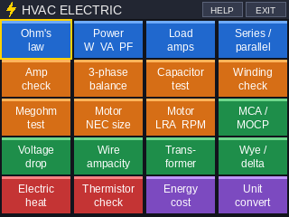 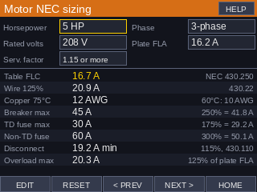

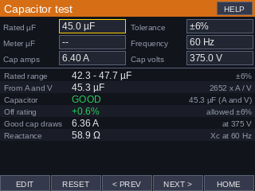 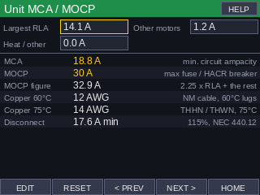

## Installing HVACELEC

Follow the [SUPERSUB steps](#install-drag-and-drop-no-typing) with the HVACELEC files. Download [`HVACELEC.zip`](https://github.com/christophercasteel2/Subheat-subcool-app/raw/ccr-d1b6c2f8-hvvb6p/calculator/HVACELEC.zip) and unzip it. Then, in the Connectivity Kit, drag the `HVACELEC.hpappdir` folder onto **Application Library** under your calculator. If the app doesn't show up, drag `HVACELEC.hpprgm` onto **Programs** instead. On the calculator, press **Apps** and tap **HVACELEC**.

## Using HVACELEC

| Action | Touch | Keys |
|---|---|---|
| Open a tool | Tap its tile | Arrows, then Enter. Menu lists every tool |
| Change a value | Tap its box. A number box opens a number entry, a list opens a chooser, and a two-way choice (1-phase / 3-phase) just flips | Select the box with Left/Right, type the number on the keypad, press Enter |
| Step a value | | Up / Down |
| Fix typing | | Del erases a digit, Esc cancels, − makes it negative |
| Put the example values back | **RESET** | |
| Next or previous tool | **NEXT >** / **< PREV** | |
| How the tool works | **HELP** (top right) | Help |
| Back to the tiles / quit | **HOME** / **EXIT** | Esc |

A box showing `--` is optional and is ignored while it is 0. In Ohm's law, `?` marks the values to work out. Your values are kept between runs.

## HVACELEC tools

| Tile | Inputs | What you get |
|---|---|---|
| **Ohm's law** | Any two of volts, amps, ohms and watts | The other two, and the formulas used |
| **Power** | Volts, amps, phase, power factor, efficiency | Watts, VA, VAR, BTU/h and motor output HP |
| **Load amps** | A load in W, kW, HP (motor output) or BTU/h; volts, phase, PF, efficiency | Amps, input watts and VA, the 125% continuous-load figure and the copper wire for it |
| **Series / parallel** | Up to four resistors or capacitors, and the source voltage | Total resistance or capacitance. For resistors: the current, power, and each part's volts or amps. For capacitors in series: the volts on each |
| **Amp check** | Nameplate voltage, measured volts, RLA or FLA, clamp reading, wraps through the clamp | The allowed voltage range (nameplate ±10%: 187–253 V for 208-230 V), a voltage verdict, the running amps and the % of rated load |
| **3-phase balance** | Three line voltages and three line currents | % voltage unbalance (NEMA method), the NEMA derating factor, % current unbalance, and the high and low legs |
| **Capacitor test** | Rated µF and tolerance; a meter reading, or the running amps through and volts across the capacitor | Measured µF (2652 × A ÷ V at 60 Hz), GOOD / WEAK / HIGH against the tolerance, % off rating, and the amps a good capacitor draws |
| **Winding check** | 1- or 3-phase, ohms between each pair of terminals, winding temperature | Single phase: which terminal is common, run and start, whether C-R + C-S equals S-R, and the open-overload and open-winding patterns. Three phase: whether the windings match. Readings corrected to 77°F for comparing with the spec |
| **Megohm test** | 1-minute reading and winding temperature; optional 10-minute and 30-second readings | The reading corrected to 40°C and checked against the IEEE 43 minimum (5 MΩ for windings under 1000 V), the polarization index and the dielectric absorption ratio |
| **Motor NEC sizing** | HP, phase, voltage, nameplate FLA, service factor | Table full-load current (NEC 430.248 / 430.250), the 125% wire size, the largest breaker and fuses (430.52, next standard size up), the disconnect (115%) and the overload setting (430.32) |
| **Motor LRA and RPM** | Code letter, HP, volts, phase, nameplate RPM, Hz | Locked-rotor kVA per HP and the LRA range (NEC 430.7(B)), poles, synchronous speed and slip |
| **Unit MCA / MOCP** | Largest motor's RLA, the other motors' FLAs, electric heat amps | MCA = 1.25 × largest + other motors + 1.25 × heat. MOCP = 2.25 × largest + the rest, rounded down to a standard size but never below the MCA. Copper wire at 60°C and 75°C, and the disconnect rating |
| **Voltage drop** | Amps, one-way length, wire size and material, phase, source volts, allowed % | Volts and % dropped, volts at the load, the smallest wire within the limit, and the wire's ampacity |
| **Wire ampacity** | Size, copper or aluminum, insulation and terminal ratings, ambient temperature, number of current-carrying wires, rooftop exposure | The Table 310.16 ampacity, the ambient and bundling factors, the derated and terminal-limited ampacity, and the largest breaker (240.4(B) and (D)) |
| **Transformer** | VA, phase, primary and secondary volts, measured secondary amps | Turns ratio, primary and secondary full-load amps, % loaded, and the largest primary fuse (NEC 450.3(B)) |
| **Wye / delta** | Hookup, line volts, line amps | Line-to-neutral or phase voltage, phase current, kVA, and the high leg of a center-tapped delta |
| **Electric heat** | Rated kW and volts, applied volts, phase, measured amps, temperature rise | Output at the applied voltage (kW goes with V²), BTU/h, amps, element resistance, measured kW, airflow (CFM = BTU/h ÷ (1.08 × rise)) and the 125% circuit amps |
| **Thermistor check** | Curve (10K Type II, 10K Type III, or custom R at 77°F and Beta), reading in kΩ, actual temperature | The temperature the reading means, the resistance it should have, the difference, and the curve's resistance at 32°F, 77°F and 100°F |
| **Energy cost** | Volts, amps, phase, PF, $/kWh, hours a day, optional cooling capacity | kW, and the cost per hour, day, month and year. With the capacity: EER, COP and kW per ton |
| **Unit converter** | Kind of value, the number and its unit | Power (W, kW, HP, BTU/h, MBH, tons), energy, current, voltage, resistance, capacitance (MFD = µF) and temperature |

## HVACELEC code tables and sources

The tables are typed into `tools/gen_elec_tables.py`, which writes them into the program. The tests check spot values copied from the sources separately.

| Data | Used by | Checked against |
|---|---|---|
| NEC Table 430.248 and 430.250, motor full-load current | Motor NEC sizing | [Elliott Electric's 430.248 table](https://elliottelectric.com/StaticPages/ElectricalReferences/ElectricalTables/Amperes_Single_Phase_Alternate.aspx), [Transcat's full-load current reference](https://www.transcat.ca/media/pdf/FullLoadCurrent.pdf) (both tables), [VoltageLab](https://www.voltagelab.com/?p=10433) |
| NEC Table 310.16 ampacity, copper and aluminum, 60/75/90°C, 14 AWG to 500 kcmil | Every wire size, Wire ampacity | [Cerrowire's ampacity chart](https://www.cerrowire.com/products/resources/tables-calculators/ampacity-charts/) and [Omnicable's NEC ampacity data](https://www.omnicable.com/docs/default-source/technical-resources/nec-ampacity-data.pdf). Both reproduce the 2017 table, which has the same values as 2020/2023 Table 310.16 |
| NEC Chapter 9 Table 8 conductor areas; K = 12.9 (copper), 21.2 (aluminum) | Voltage drop | |
| NEC 240.6(A) standard sizes, 240.4(D) small-conductor limits | Breaker and fuse sizes | |
| NEC Table 430.7(B) code letters | Motor LRA | A–P and V from [EEPower](https://eepower.com/technical-articles/the-meaning-behind-motor-and-multi-motor-marking/); R–U fill the gap between them |
| NEMA MG 1 voltage-unbalance derating curve: 1.00 up to 1%, then 0.95 at 2%, 0.88 at 3%, 0.82 at 4% and 0.75 at 5% | 3-phase balance | Approximate. Published copies of the curve differ by about 0.01 ([electrical-engineering-portal](https://electrical-engineering-portal.com/voltage-unbalance-nema-motor-performance)) |
| Ambient correction from the NEC 310.15(B) equation | Wire ampacity | Gives the code's correction-factor tables (for example 0.91 for 90°C wire at 104°F) |
| 10K Type III thermistor, Steinhart-Hart | Thermistor check | Within 0.02°F of BAPI's 10K-3 table from −39°F to 187°F (`tools/data/thermistor_10k3_bapi.csv`) |
| 10K Type II thermistor, Steinhart-Hart (32,650 Ω at 32°F) | Thermistor check | Within 0.1% of published 10K Type II charts from 32°F to 68°F |
| IEEE 43 temperature correction, 5 MΩ minimum and PI guide | Megohm test | |

The NEC values are for checking and learning. The equipment nameplate, the manufacturer's instructions and your local code come first. Lock out the power and prove it dead before you test resistance, capacitors or insulation.

# NECCALC: NEC calculator for electrical class

A separate app built for an electrical class. It follows the **2026 NEC as adopted in Arkansas** (17 CAR 210-401, effective September 3, 2026), with the Arkansas amendments on the GFCI/AFCI Learn page. It has every calculator, chart and guide on [electricalcalctools.com](https://electricalcalctools.com) as a tile, plus **Learn** pages, with the same tap-a-box or type-on-the-keypad entry as HVACELEC. It shares nothing with the other apps, so deleting it from the calculator after the class leaves them untouched.

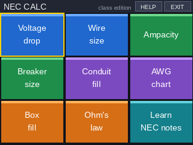 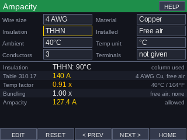

Download [`NECCALC.zip`](https://github.com/christophercasteel2/Subheat-subcool-app/raw/ccr-d1b6c2f8-hvvb6p/calculator/NECCALC.zip), unzip it, and drag `NECCALC.hpappdir` onto **Application Library** (or `NECCALC.hpprgm` onto **Programs**). To remove it later, delete it from the Application Library (or Programs) in the Connectivity Kit or on the calculator.

| Tile | What it does |
|---|---|
| **Voltage drop** | VD, % drop and volts at the load for 1- or 3-phase, by K (12.9 Cu, 21.2 Al) or Chapter 9 Table 8 resistance; the smallest wire and longest run for your % limit |
| **Wire size** | Smallest wire for a load (125% if continuous): the insulation column after the temperature factor, the terminal column, 240.4(D) for the breaker, and 3% / 5% voltage drop for the run and system (120–600 V, 1- or 3-phase) |
| **Ampacity** | Any size 18 AWG–2000 kcmil, copper or aluminum, any insulation type (TW, UF, RHW, THHW, THW, THWN, XHHW, USE, ZW, TBS, SA, SIS, FEP, FEPB, MI, RHH, RHW-2, THHN, THW-2, THWN-2, USE-2, XHH, XHHW-2, ZW-2, NM-B), in a raceway or cable (Table 310.16) or **free air (Table 310.17)**; ambient correction (310.15(B)(1), in °C or °F), bundling (310.15(C)(1)), optional terminal limit, and 240.4(D) |
| **Breaker size** | 125% of continuous + noncontinuous to the next standard size, whether the wire is big enough, and the largest breaker the wire allows |
| **Conduit fill** | How many wires fit (with Note 7 rounding), or the smallest conduit for your wires (with a second group, such as a ground), for EMT, FMC, IMC, RMC and PVC 40/80; THHN/THWN, XHHW, TW/THW, RHW (no jacket) and FEP areas |
| **AWG chart** | Circular mils, mm², diameter, Table 8 resistance, 310.16 and 310.17 ampacities in all three columns, your insulation's ampacity, its Table 5 area and the size's common use |
| **Feeder size** | Feeder or service wire by ampacity (with the 83% dwelling rule of 310.12) and by a 2, 3 or 5% voltage drop; the drop at the chosen size and the 250.122 ground |
| **Ground wire** | Equipment ground from the breaker rating (Table 250.122, up to 4000 A) or grounding electrode conductor from the service wire (Table 250.66), in copper and aluminum, with the rod / concrete-encased / ring limits |
| **Box fill** | 314.16(B) counts (wires, clamps, yokes, grounds, fittings) × volume per wire, for 20 Table 314.16(A) boxes or a custom volume |
| **MCA / MOCP** | MCA = 1.25 × RLA + fans + other, the wire for it (Cu and Al 75°C, Cu 60°C), and the MOCP from 175% (next standard size) capped at 225%, or the nameplate MOP |
| **Power calc** | Any two of V, I, R, W, with power factor and 1- or 3-phase: watts, VA, VAR, kW, kVA |
| **Ohm's law** | Any two of E, I, R, P |
| **kWh** | Daily, monthly and yearly kWh and cost of a device; amps at 120 and 240 V |
| **Elec. cost** | Monthly, yearly and daily cost from kWh, with the site's average rate for each state or your own rate |
| **Derating** | Base ampacity × 310.15(B)(1) temperature factor × 310.15(C)(1) bundling factor |
| **VD table** | % and volts dropped at 25–300 ft for a size, load and system, colored by the 3% / 5% limits, and the longest run for each |
| **Breaker / wire chart** | For each standard breaker 15–800 A: copper and aluminum wire in the 60°C and 75°C columns (240.4(D) included, parallel sets above 2000 kcmil), the 250.122 ground and the 80% continuous load |
| **Appliances** | Breaker, copper and aluminum wire, outlet and NEC section for dryers, ranges, ovens, cooktops, water heaters, tankless heaters, hot tubs, EV chargers (16–80 A), mini-splits, A/C, well pumps, subpanels and 100/200 A dwelling services |
| **NEMA plugs** | Voltage, amps, wires, typical use and locking type of 23 NEMA configurations (1-15 to L15-30), with the 80% cord-load limit |
| **Learn** | 18 pages: Ohm's law and power, voltage drop, ampacity steps, terminals, 240.4(D), insulation letters, conduit fill, box fill, breaker sizing, AWG, GFCI vs AFCI, nameplates (MCA, MOCP, RLA, FLA, LRA), feeders and 310.12, grounding, NEMA names, temperature factors, energy and cost, appliance circuits |

**Arkansas and the 2026 NEC.** Arkansas's Board of Electrical Examiners adopted the [2026 NEC with amendments](https://labor.arkansas.gov/wp-content/uploads/17CARpt-210-Final.pdf): no AFCI or GFCI on dwelling circuits over 130 V (so 240 V condensers, dryers and ranges) except pools, spas and water (Articles 680 and 682); none for laundry areas except outlets within 6 ft of a sink, or for refrigerators and microwaves; and its own island and peninsula receptacle rules. NECCALC cites 2026 section numbers: load calculations moved from Article 220 to Article 120 (dryers 120.54, ranges 120.55), and 310.12's 83% dwelling rule now needs 75°C or higher rated conductors and also covers 208Y/120 V feeders, which the feeder tool applies. The 2026 Table 310.16 also adds 60°C and 75°C values for 16 AWG copper and a 14 AWG copper-clad aluminum row; those new values are not in the app, so 16 AWG copper shows only its 90°C value. The other table values used here did not change.

**Where the numbers come from.** Tables 310.16 and 310.17 (18 AWG–2000 kcmil) are copied from [Omnicable's reproduction of the NEC ampacity tables](https://www.omnicable.com/docs/default-source/technical-resources/nec-ampacity-data.pdf) (2017 numbering 310.15(B)(16)/(17); same values in 2020 and 2023). The temperature correction factors come from the code's own equation and match the printed table at every row. Chapter 9 Table 5 areas for THHN/THWN and XHHW were checked against a [published Table 5 listing](https://conduit-fill-calc.pages.dev/wire-sizes) from 14 AWG to 500 kcmil, and TW, RHW and FEP at 14–4 AWG. Table 4 areas for EMT, FMC, IMC and RMC (½–2 in) were checked against a [conduit-fill dataset](https://huggingface.co/datasets/anthonymeo/conduitFill), and PVC at several sizes. The tests also reproduce Annex C counts (for example 26 #12 THHN in 1 in EMT). Table 8 copper resistances for 14–6 AWG match a [Mike Holt sample](https://www.mikeholt.com/instructor2/img/product/pdf/1220452413sample.pdf); every value passes resistance × circular mils ≈ 12.9 (Cu) or 21.2 (Al). The larger TW/THW areas and the remaining Table 8 values were not checked against a second source, so compare with your code book if an answer looks off. Tables 250.122, 250.66, 314.16(A) and 310.12 were typed from the code and spot-checked by the tests. The appliance guide, NEMA list and state rates follow the website, but the wire sizes are recomputed from Table 310.16 and 240.4(D): where the site's own charts disagree with the NEC (for example its 3 AWG copper at 90°C and parts of its ground and EV charts), the app uses the NEC value.

Use the app only where your instructor allows calculators with programs or stored tables.

# HVACGAS: gas heating and piping

An app for the gas heating, fuel gas code and piping parts of the HVACR courses (installation, HVAC III, systems and components), set up for **Arkansas**: it follows the **2018 Arkansas Fuel Gas Code** (the 2018 IFGC with Arkansas amendments, from the Arkansas Department of Health). It uses the same tap-a-box or type-on-the-keypad entry as the other apps, and has 19 tools plus **Learn** pages on the code rules.

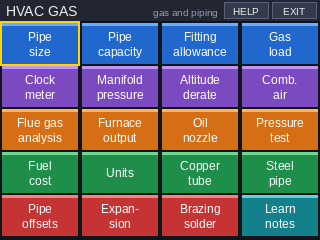 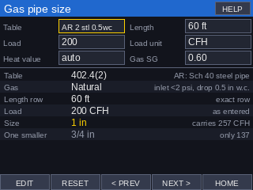

Download [`HVACGAS.zip`](https://github.com/christophercasteel2/Subheat-subcool-app/raw/ccr-d1b6c2f8-hvvb6p/calculator/HVACGAS.zip), unzip it, and drag `HVACGAS.hpappdir` onto **Application Library** (or `HVACGAS.hpprgm` onto **Programs**).

| Tile | What it does |
|---|---|
| **Pipe size** | Pick one of the eight Arkansas tables, 402.4(2), (5), (7) steel, (9), (12), (14) copper and (21), (22) PE (natural gas), or an IFGC propane table marked LP reference; then the length and the load (CFH, kBtu/h or Btu/h). It uses the table row equal to or longer than your length, converts the load with the heating value (1,000 Btu/ft³ natural gas, 2,516 propane, or yours), applies the Table A102.4 gravity factor, and gives the size, what it carries and the next size down |
| **Pipe capacity** | Every size's capacity in one table at one length, as the code book prints it |
| **Fitting allowance** | Equivalent length of screwed 90° and 45° ells, tees and gate valves from Appendix A Table A102.2, and the total length to size with |
| **Gas load** | Up to six appliances: total Btu/h, kBtu/h, CFH, therms or LP gallons and pounds per hour |
| **Clock meter** | CFH and Btu/h from the test dial and seconds, the percent of the plate input, and the seconds per revolution to aim for |
| **Manifold pressure** | The manifold pressure that brings the clocked input to the rated input (flow follows the square root of pressure) |
| **Altitude derate** | 4% per 1,000 ft above 2,000 ft by default (both editable) |
| **Combustion air** | Arkansas 304: required volume (standard method, or known infiltration, which Arkansas requires a licensed mechanical engineer to verify), room volume, indoor openings, two outdoor openings (direct/vertical or horizontal ducts), one opening, each outdoor opening at least 12 in² (Arkansas), louver sizes at 75% metal or 25% wood free area, and the combination factor |
| **Flue gas analysis** | CO2, excess air, CO air-free and net stack temperature for natural gas, propane or #2 oil, with an efficiency estimate |
| **Furnace output** | Output from input and efficiency, and airflow from the temperature rise (or the rise from the airflow) |
| **Oil nozzle** | Firing rate, the nozzle size at 100 psi, and a nozzle's flow and input at another pump pressure |
| **Pressure test** | Arkansas 406.4: test pressure (1-1/2 times working, 3 psig minimum), pipe volume from Schedule 40 sizes, test duration (15 minutes for 250 ft³ or less or a single-family dwelling, otherwise 1/2 hour per 500 ft³) and the gauge range |
| **Fuel cost** | Cost per million Btu delivered for natural gas, propane, oil and electric (with heat pump COP) |
| **Units** | Pressure (in w.c., psi, oz/in², in Hg, kPa, mbar), energy (Btu, therms, kWh, gas ft³, LP gallons and pounds, oil gallons) and heat rate |
| **Copper tube** | Type K, L, M and ACR (soft and hard) dimensions, weight, volume, marking color, whether it is allowed for fuel gas, and support spacing |
| **Steel pipe** | Schedule 40 dimensions, weight, volume, threads per inch, support spacing and a 90° ell's equivalent length |
| **Pipe offsets** | Travel, run and cut length for 11-1/4°, 22-1/2°, 30°, 45° and 60° offsets, including rolling offsets, to the nearest 1/16 in |
| **Expansion** | Expansion of copper (CDA coefficient), steel, PVC, CPVC, aluminum or your own coefficient |
| **Brazing / solder** | BCuP and BAg brazing alloys and two solders: silver and phosphorus content, solidus and liquidus, and flux notes |
| **Learn** | 14 pages: sizing gas piping, table notes, combustion air, pressure testing, valves/traps/supports, meter and manifold, flue gas, oil burners, venting, copper tube, brazing, offsets, fuels and units, furnace airflow |

**Arkansas.** The 2018 Arkansas Fuel Gas Code ([Arkansas Department of Health](https://healthy.arkansas.gov/wp-content/uploads/Fuel_Gas_Code_2018.pdf); [full text](https://www.arkleg.state.ar.us/Home/FTPDocument?path=%2FAssembly%2FMeeting+Attachments%2F040%2F4620%2FD.03b+ADH+2018+AR+Fuel+Gas+Code.pdf)) keeps eight of the IFGC sizing tables, all natural gas, and deletes the rest, including every CSST table (CSST is sized by the manufacturer's instructions, 403.5.5) and every propane table (LP-gas is under the Arkansas LP-Gas Board). The app checks its eight tables value by value against the printed Arkansas code; Arkansas Table 402.4(21) stops at 2 in. Other Arkansas changes the app follows: the branch length method is deleted (longest length or hybrid pressure only); pressure tests run 15 minutes for 250 ft³ or less or a single-family dwelling, and otherwise 1/2 hour per 500 ft³ (Arkansas dropped the IFGC's "or fraction thereof", so the app shows the proportional time and the IFGC's rounded-up time); each outdoor combustion air opening has at least 12 in² free area; the known-infiltration method must be verified by a licensed mechanical engineer; copper gas tubing needs the gas supplier's approval (403.5); and sediment traps are not needed for lights, ranges, clothes dryers and outdoor grills. The propane tables are the IFGC's, kept as a reference and marked "LP".

**Where the numbers come from.** The capacity values are the IFGC 2018/2021 Tables 402.4, read from the [2021 Seattle Fuel Gas Code chapter 4](https://www.seattle.gov/documents/Departments/SDCI/Codes/FuelGasCode/2021SFGCChapter4.pdf), which prints the IFGC tables without changes, checked entry by entry against the [2018 edition](https://www.seattle.gov/documents/Departments/SDCI/Codes/FuelGasCode/2018SFGCChapter4.pdf) and, for the Arkansas tables, against the Arkansas code. Every value is stored as printed. A printed entry that looks like a typo (12,000 at 400 ft for 3 in PE in propane Table 402.4(36)) is kept as printed. Table 402.4(37) says "cubic feet of gas per hour" but its values are thousands of Btu/h like the other propane tables, and the app treats it that way. The fitting lengths and gravity factors are from Appendix A, and the combustion air, testing, valve, trap and support rules from the Arkansas code sections 304, 406, 408, 409 and 415. Copper tube dimensions and weights, the brazing alloy table and the copper expansion coefficient are from the CDA Copper Tube Handbook (A4015-14/17), checked against a mill's ASTM dimension sheet; the handbook prints BAg-34's silver as "37.0-34.0", which the app gives as 37.0-39.0. Steel weights use the ASME B36.10 formula. The expansion coefficients other than copper, the flue gas CO2 maximums and the Siegert efficiency estimate are common handbook values rather than code values, so check them against your course material.

# REFCYCLE: refrigeration cycle and service

An app for the systems and components and the service courses: "the computation of temperature-pressure relationship and related problems", commercial refrigeration loads, EPA rules and the paperwork of a service call. 19 tools plus **Learn**.

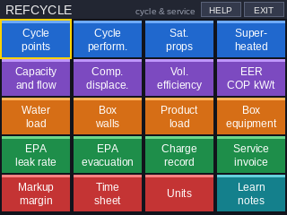 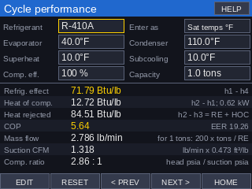

Download [`REFCYCLE.zip`](https://github.com/christophercasteel2/Subheat-subcool-app/raw/ccr-d1b6c2f8-hvvb6p/calculator/REFCYCLE.zip), unzip it, and drag `REFCYCLE.hpappdir` onto **Application Library** (or `REFCYCLE.hpprgm` onto **Programs**).

| Tile | What it does |
|---|---|
| **Cycle points** | Refrigerant (R-22, R-410A, R-134a, R-404A, R-407C, R-32, R-507A, R-290, R-12), evaporating and condensing temperatures **or gauge pressures**, superheat, subcooling and compressor efficiency: the enthalpy of the four points of the cycle, the discharge temperature, the liquid temperature and the flash gas |
| **Cycle perform.** | Refrigeration effect, heat of compression (and compressor kW), heat of rejection, COP and EER, lb/min for the capacity, suction CFM and compression ratio |
| **Sat. props** | Bubble and dew pressures, glide, liquid and vapor enthalpy, latent heat, vapor volume and entropy at a temperature |
| **Superheated** | Pressure, temperature, enthalpy, entropy and volume of superheated vapor |
| **Capacity and flow** | Btu/h and tons from the mass flow and refrigeration effect, or the flow needed for a capacity |
| **Comp. displace.** | Displacement and actual CFM from bore, stroke, cylinders, RPM and volumetric efficiency, and the capacity at the cycle tool's conditions |
| **Vol. efficiency** | Compression ratio and volumetric efficiency from the clearance volume |
| **EER COP kW/t** | Converts between EER, COP and kW per ton |
| **Water load** | Btu/h and tons from GPM and temperature difference, GPM per ton, cooling tower range and approach |
| **Box walls / Product load / Box equipment** | Walk-in loads: wall, ceiling and floor transmission from the R-value; product cooling, freezing and below-freezing loads; the equipment Btu/h from the daily total, safety factor and run time |
| **EPA leak rate** | Annualizing or rolling-average leak rate (40 CFR 84.102), whether the leak repair rule applies (HFC/HFO appliances of 15 lb or more since January 1, 2026, 84.106; CFC/HCFC of 50 lb or more, 82.157; residential and light commercial A/C is excluded), the 10/20/30% limit, the 30-day repair and verification deadlines and the 125% chronic-leaker report |
| **EPA evacuation** | The required recovery vacuum from 40 CFR 82.156 Table 1, with the appliance pressure class worked out from the liquid pressure at 104°F (82.152), small appliances, and the 0 psig and 5 psig rules |
| **Charge record** | Refrigerant added and recovered by cylinder weights, in lb and lb-oz |
| **Service invoice** | Labor, marked-up parts, refrigerant, trip charge, tax and total |
| **Markup margin** | Price, profit, markup and margin from either one |
| **Time sheet** | Hours worked from the clock times and break, regular and overtime hours for the week, and pay |
| **Units** | Enthalpy, entropy, specific volume, capacity, pressure and mass flow in I-P and SI units |
| **Learn** | 12 pages: the cycle, cycle numbers, the enthalpy reference, compressors, box loads, EPA leak repair for HFCs and for CFC/HCFCs, EPA records, evacuation levels, Arkansas HVACR license classes, service paperwork, water and efficiency formulas |

**Where the numbers come from.** Refrigerant properties are generated from [CoolProp](http://www.coolprop.org/) (the same reference equations of state as NIST REFPROP for these refrigerants) on a grid every 5°F of saturation temperature and every 10°F of superheat, and the program interpolates with quadratics. Against CoolProp called directly, the tests find the saturation pressures within 0.002 psi and the enthalpies within 0.005 Btu/lb at random states, and whole cycles within 0.06 Btu/lb and 0.3°F. Enthalpy and entropy use the **ASHRAE reference** (0 for saturated liquid at -40°F); a P-H chart with another reference gives h values that differ by a constant, but the same refrigeration effect, heat of compression and COP. For blends, the evaporating and condensing temperatures are dew points, as on compressor ratings, and the liquid uses the bubble point at the head pressure; subcooled liquid takes the enthalpy of saturated liquid at its temperature, the usual textbook method. R-454B and the other newer blends are left out because CoolProp's models for them read about 1% off the manufacturers' tables. The EPA rules are typed from the current [eCFR](https://www.ecfr.gov/current/title-40/chapter-I/subchapter-C/part-84/subpart-C/section-84.106) text of 40 CFR 82.152, 82.156, 82.157, 84.102 and 84.106 (as of October 2026); by the 82.152 definition, R-32 (359 psia at 104°F) is a very high-pressure refrigerant. The Arkansas license classes are from the HVACR Licensing Board's rules.

The program file is about 400 KB on the calculator, larger than the other apps, because of the property tables; if it is slow to open the first time, give it a few seconds.

# CIRCUITS: DC circuits for electricity class

An app for the electricity class: the series, parallel and combination circuit problems of the homework, Kirchhoff's laws and troubleshooting. Each tool has its input boxes down the left and every answer down the right, so you can read off whatever the question asks for (RT, IT, ET, PT, or any resistor's E, I or P). 12 tools plus **Learn**.

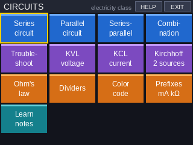 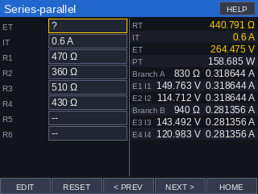

Download [`CIRCUITS.zip`](https://github.com/christophercasteel2/Subheat-subcool-app/raw/ccr-d1b6c2f8-hvvb6p/calculator/CIRCUITS.zip), unzip it, and drag `CIRCUITS.hpappdir` onto **Application Library** (or `CIRCUITS.hpprgm` onto **Programs**).

| Tile | What it does |
|---|---|
| **Series** | Up to 7 resistors in series; give ET or IT. RT, IT, ET, PT and each resistor's voltage drop and power |
| **Parallel** | Up to 7 resistors in parallel; RT, IT, ET, PT and each branch current and power |
| **Series-parallel** | Two or three parallel branches of two resistors in series ((R1 + R2) ‖ (R3 + R4) ‖ (R5 + R6)): RT, ET or IT, each branch's resistance and current, and each resistor's voltage and current |
| **Combination** | The chain R1 – (R2 ‖ R3) – R4 – (R5 ‖ R6) – R7 (a 0 leaves a resistor out): RT, IT, ET, PT and each resistor's voltage and current |
| **Troubleshoot** | The two-branch circuit with your voltmeter readings and measured current: the normal readings, and which resistor is open or shorted (the closest match out of all of them open, shorted or OK) |
| **KVL voltage** | Kirchhoff's voltage law: the missing voltage drop (or ET) around a loop |
| **KCL current** | Kirchhoff's current law: the unknown current into or out of a junction, and what a negative answer means (the assumed direction was wrong) |
| **Kirchhoff 2 sources** | Two sources, each with a resistor, feeding a middle resistor: the top node voltage and I1, I2, I3 with their directions, checked with KCL |
| **Ohm's law** | Any two of E, I, R and P give the other two |
| **Dividers** | Voltage divider (two in series) and current divider (two in parallel) |
| **Color code** | 4- and 5-band resistors: value, tolerance and the lowest and highest value |
| **Prefixes** | A value in every metric prefix, pico to giga (15 mA = 0.015 A) |
| **Learn** | 11 pages: series, parallel, series-parallel steps, KVL, KCL, two-source networks, troubleshooting, Ohm's law and power, dividers, color code and prefixes |

Answers show six significant figures (0.318644 A, 5627.11 Ω). The tests work the homework problems again with plain arithmetic: (470 + 360) ‖ (510 + 430) at 0.6 A gives RT = 440.791 Ω and I2 = 0.318644 A; the 63 V combination chain gives RT = 5627.11 Ω; the 12 V troubleshooting readings (E1 12 V, E2 0 V, E3 7 V, E4 5 V, 15 mA) give R1 open.

# Android apps

Every app also runs on an Android phone or tablet (Android 5 or newer) as its own app, with its own icon. It is the same program as on the calculator: the calculator screen at the top (tap it the same way) and the calculator's keys below it (the arrows, Enter, Esc, Del, the digits and Help, Menu, Symb, Plot and Num). Turn the phone sideways for a bigger screen. Number boxes open the phone's keyboard; choice boxes open a list. The phone's Back button works as Esc.

| App | Download |
|---|---|
| SUPERSUB | [`SUPERSUB.apk`](https://github.com/christophercasteel2/Subheat-subcool-app/raw/ccr-d1b6c2f8-hvvb6p/android/SUPERSUB.apk) |
| HVACAIR | [`HVACAIR.apk`](https://github.com/christophercasteel2/Subheat-subcool-app/raw/ccr-d1b6c2f8-hvvb6p/android/HVACAIR.apk) |
| NECCALC | [`NECCALC.apk`](https://github.com/christophercasteel2/Subheat-subcool-app/raw/ccr-d1b6c2f8-hvvb6p/android/NECCALC.apk) |
| HVACELEC | [`HVACELEC.apk`](https://github.com/christophercasteel2/Subheat-subcool-app/raw/ccr-d1b6c2f8-hvvb6p/android/HVACELEC.apk) |
| HVACGAS | [`HVACGAS.apk`](https://github.com/christophercasteel2/Subheat-subcool-app/raw/ccr-d1b6c2f8-hvvb6p/android/HVACGAS.apk) |
| REFCYCLE | [`REFCYCLE.apk`](https://github.com/christophercasteel2/Subheat-subcool-app/raw/ccr-d1b6c2f8-hvvb6p/android/REFCYCLE.apk) |
| CIRCUITS | [`CIRCUITS.apk`](https://github.com/christophercasteel2/Subheat-subcool-app/raw/ccr-d1b6c2f8-hvvb6p/android/CIRCUITS.apk) |

**Installing:** on the phone, tap the APK link above (or open the file you downloaded). Android asks to allow installs from that app (Chrome, Files or Drive); allow it, then tap **Install**. The apps are not from the Play Store, so Play Protect may ask you to confirm; tap **More details → Install anyway** (or **Install without scanning**). The apps need no permissions and work without internet. A newer APK installs over the old one.

**How it works.** `tools/ppl2js.py` translates each calculator program (`hp-prime/NAME.txt`) into JavaScript, using the simulator's own parser, and `tools/android/runtime.js` supplies the calculator's built-in functions: drawing on a canvas with the simulator's font (Liberation Sans, SIL Open Font License), the touch and key events, and the INPUT, CHOOSE and MSGBOX dialogs. `tools/build_android.py` packs each one into an Android app (a full-screen WebView) with the Android SDK's own tools. `tools/test_android.py` plays the same random taps, drags, keys and dialog answers through the simulator and through the translated program, and checks that every variable comes out the same, so the program tests above hold for the Android apps too. `tools/android/test_page.js` drives the app page in a phone-sized Chromium.

The APKs are signed with a key kept out of the repository (`tools/android/apps.keystore`, made by the build script if it is missing). Android installs an update over an app only when both are signed with the same key, so if the APKs are ever rebuilt with a new key, uninstall the old app first.

# Development

## Repository layout

```
calculator/               ready-to-install files (built, do not edit by hand)
  SUPERSUB.hpappdir/        app: drag onto Application Library
  SUPERSUB.hpprgm           program: drag onto Programs
  SUPERSUB.zip              both, for one download
  HVACELEC.hpappdir/, HVACELEC.hpprgm, HVACELEC.zip   the same for HVACELEC
  HVACAIR.hpappdir/, HVACAIR.hpprgm, HVACAIR.zip      the same for HVACAIR
  NECCALC.hpappdir/, NECCALC.hpprgm, NECCALC.zip      the same for NECCALC
  HVACGAS.hpappdir/, HVACGAS.hpprgm, HVACGAS.zip      the same for HVACGAS
  REFCYCLE.hpappdir/, REFCYCLE.hpprgm, REFCYCLE.zip   the same for REFCYCLE
  CIRCUITS.hpappdir/, CIRCUITS.hpprgm, CIRCUITS.zip   the same for CIRCUITS
android/NAME.apk          the Android apps (built, do not edit by hand)
hp-prime/SUPERSUB.txt     SUPERSUB's readable source (HP PPL)
hp-prime/HVACELEC.txt     HVACELEC's readable source (HP PPL)
hp-prime/HVACAIR.txt      HVACAIR's readable source (HP PPL)
hp-prime/NECCALC.txt      NECCALC's readable source (HP PPL)
hp-prime/HVACGAS.txt      HVACGAS's readable source (HP PPL)
hp-prime/REFCYCLE.txt     REFCYCLE's readable source (HP PPL)
hp-prime/CIRCUITS.txt     CIRCUITS's readable source (HP PPL)
tools/gen_pt_tables.py    builds the P-T data block inside SUPERSUB.txt
tools/gen_elec_tables.py  builds the tool, input-box and NEC table block inside HVACELEC.txt
tools/gen_air_tables.py   builds the tool and input-box block inside HVACAIR.txt
tools/gen_nec_tables.py   builds the tool, input-box and NEC table block inside NECCALC.txt
tools/gen_gas_tables.py   builds the tool, input-box and code table block inside HVACGAS.txt
tools/gen_cycle_tables.py builds the tool, input-box and refrigerant property block inside REFCYCLE.txt (needs CoolProp)
tools/gen_circ_tables.py  builds the tool and input-box block inside CIRCUITS.txt
tools/ppltables.py        helpers both table generators share
tools/build_calc_files.py builds the calculator/ folder from both sources
tools/hpfile.py           writes the calculator's program-file format
tools/hpapp/              format templates for the program and app files
tools/data/*.csv          published P-T tables used for the blends, liquid densities,
                          and BAPI's 10K-3 thermistor table
tools/data/check/         published liquid pressures used to check CoolProp blend models
tools/ppl_sim.py          small PPL interpreter: runs SUPERSUB, checks it, renders screenshots
tools/test_hvacelec.py    the same for HVACELEC
tools/test_hvacair.py     the same for HVACAIR (checked against CoolProp)
tools/test_neccalc.py     the same for NECCALC (checked against published NEC values)
tools/test_hvacgas.py     the same for HVACGAS (all 37 IFGC pipe tables checked)
tools/test_refcycle.py    the same for REFCYCLE (checked against CoolProp and the EPA rules)
tools/test_circuits.py    the same for CIRCUITS (checked against the homework problems)
tools/ppl2js.py           translates a PPL program into JavaScript for the Android apps
tools/android/            the Android runtime (runtime.js), page (shell.html), signing key and test drivers
tools/build_android.py    builds android/NAME.apk (needs the Android SDK, a JDK and Node)
tools/test_android.py     checks the translated programs against the simulator
tools/data/gas/           IFGC Table 402.4 and Appendix A tables, CDA copper tube data
docs/screens/             screenshots made by the simulator
```

The calculator files contain the full readable source, so you can also read and edit the programs on the calculator. To change one here, edit its file in `hp-prime/`, then rebuild with `python3 tools/build_calc_files.py`. For the tools, input boxes and tables of HVACELEC, HVACAIR, NECCALC or HVACGAS, edit its `tools/gen_*_tables.py` and run it first; it writes the table block into the program.

### Adding a refrigerant

1. Add a line to `REFRIGERANTS` in `tools/gen_pt_tables.py`. Give it the display name, a source (a CoolProp fluid name, or a CSV file in `tools/data` with `temp_F,bubble,dew` columns in psia or psig), a cylinder color and a short description.
2. Run `pip install CoolProp`, then `python3 tools/gen_pt_tables.py --check`.
3. Run `python3 tools/ppl_sim.py` to re-run the checks and regenerate the screenshots.
4. Run `python3 tools/build_calc_files.py` to rebuild the files in `calculator/`. It checks that the files read back correctly and runs the simulator on both the app and the program.

### Simulator

`tools/ppl_sim.py` runs the real program source with scripted key presses and touches. It checks the saturation math, the controls and the screen flow, and checks every tool's answers against an independent calculation (CoolProp refrigerant and humid-air properties, the Murphy-Koop ice vapor pressure equation and the gas law). `tools/test_hvacelec.py` and `tools/test_hvacair.py` use the same interpreter for the other two apps; HVACAIR's moist-air answers are compared with CoolProp's humid-air model. The simulator also rejects a `LOCAL` with more than 8 names, which the calculator refuses. It checks each tool against its own calculation or values copied from the published tables, and plays through the tiles, typed entry, dialogs and buttons. It also enforces two PPL rules: functions must be defined before they are used, and names must not clash with calculator variables. It is a development aid. The calculator itself is the final test, so please report anything that behaves differently on real hardware. The program and app files use the same format the Connectivity Kit writes: the builder reproduces existing Connectivity Kit files byte for byte when given their contents.
